<a href="https://usaman.dev">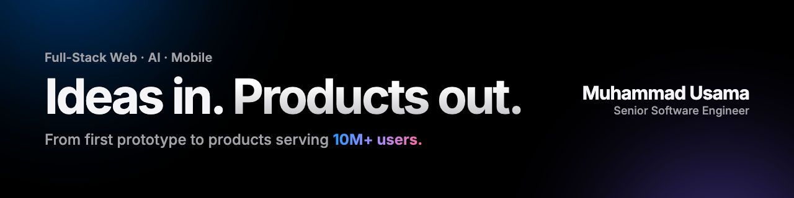</a>

### Hi, I'm Usama 👋

Senior Software Engineer building **full-stack web platforms, AI products, and mobile apps**, from the first prototype to products serving **10M+ users**.
7+ years in production. I lead a team of 7 engineers and still write code every day. I work remotely with clients in the US, Europe, and the Middle East.

   

---

### What I build

- **Full-stack web & SaaS:** web apps, dashboards, and multi-module SaaS platforms, from the interface to the database.
- **AI products:** LLM features and assistants, AI evaluation pipelines, models deployed on AWS, and AI prototypes taken to production.
- **Mobile apps:** iOS, Android, Flutter, and React Native, including offline-first sync and hardware over Bluetooth.
- **Rescue & scale:** legacy or AI-generated code made fast, stable, and premium, without stopping the business.

## Selected work

> Web platforms, AI products, and mobile apps: startups built from zero, and national-scale products from inside the engineering team. Screenshots are from each app's public App Store listing; Scheduling Platform and MapleHR screens are illustrations.

### CVS Health

*Platform and feature engineering at national scale.* 
`Enterprise` `Healthcare` `Platform` `10M+ scale`

  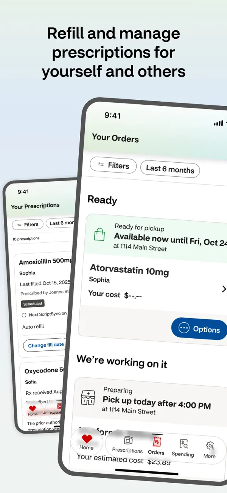
  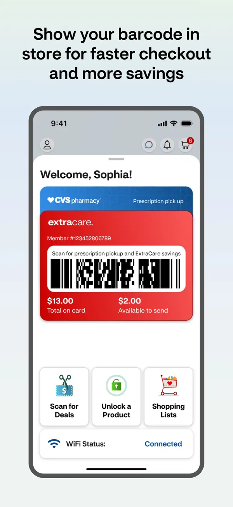
  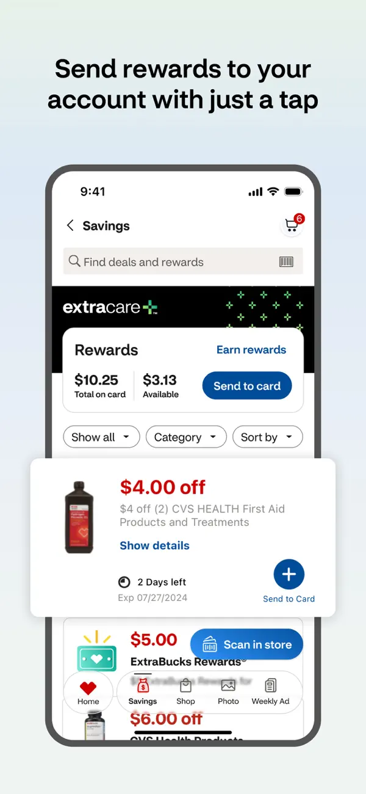

**Result: Millions.** of people served by faster feature delivery across multiple CVS apps. CVS Health app: 4.7★ from 1.6M+ App Store ratings (Sept 2026).

<b>Read the story</b>

**The challenge:** One of the largest healthcare apps in the US needed to personalize the experience for millions of people, without shipping a new app every time.

**What I did**

- **Personalized without releases.** Built server-driven UI, so the app shows each person the version of the experience that fits their needs and state, and the team can keep optimizing without waiting for App Store review.
- **Shared building blocks.** On the platform team, built micro-apps and shared packages (Authentication, Token Manager, Secure Local Storage, Update Manager, Sync) used across CVS mobile products.
- **Modernized the codebase.** Led a UIKit → SwiftUI migration on a large healthcare codebase.
- **Connected health data.** Integrated Apple Health.

**Under the hood:** Server-driven UI renders screens from backend-defined layouts. Shared capabilities ship as versioned, security-reviewed packages so every app gets the same auth, storage, and sync behavior.

`Server-driven UI` · `Micro-app architecture` · `XCFrameworks` · `SwiftUI` · `UIKit` · `Secure storage` · `HealthKit` · `HIPAA-conscious data handling` · `CI/CD`

[cvs.com ↗](https://www.cvs.com/) · [App Store ↗](https://apps.apple.com/us/app/cvs-pharmacy/id395545555)

### Ascended

*Founding engineer. A startup from zero to funded.* 
`Startup` `MVP` `Full-Stack` `Fundraising`

  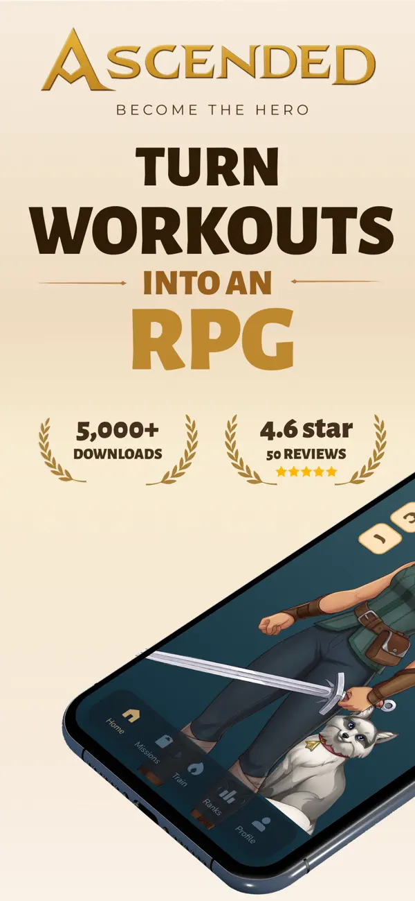
  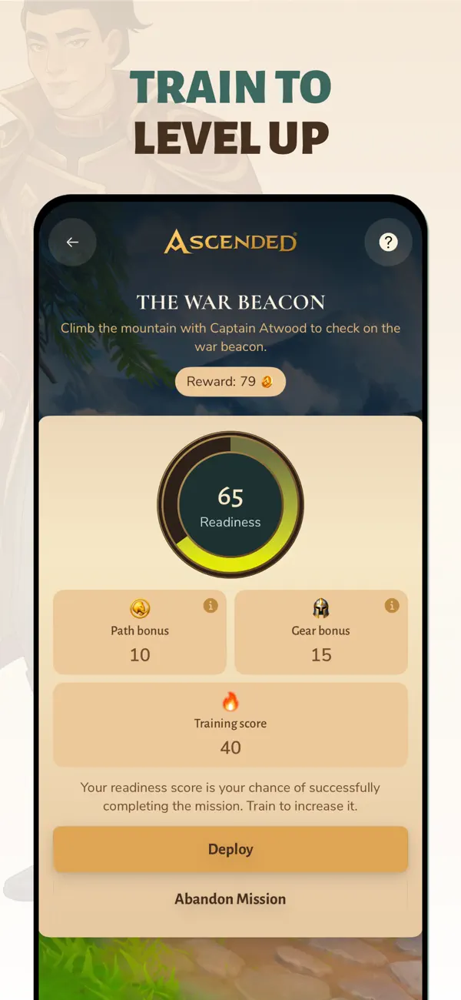
  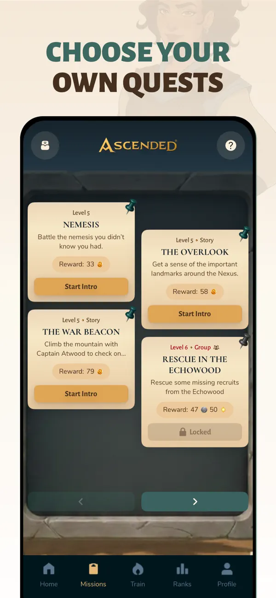

**Result: 2 rounds.** of funding supported. First 100 subscribers onboarded before launch, and the first business milestone hit within 2 months of launch. App Store rating: 4.5★+ (Sept 2026).

<b>Read the story</b>

**The challenge:** A founder had a vision for a fitness RPG, where real workouts power quests, XP, and gear, and no product yet.

**What I did**

- Turned the founder's vision into a full mobile product, owning frontend, backend, and infrastructure end to end.
- Shaped product direction and features side by side with the founders.
- Built the demo-ready product that supported two funding rounds.
- Took it all the way to a live App Store release.

**Under the hood:** Built by capability, end to end: the mobile app, the cloud backend and APIs behind it, subscriptions and payments, product analytics, and an automated release pipeline to the App Store.

`Mobile app (live on the App Store)` · `Cloud backend & APIs` · `Subscriptions & in-app purchases` · `Analytics` · `CI/CD` · `App Store releases`

[ascendedapp.com ↗](https://www.ascendedapp.com/) · [App Store ↗](https://apps.apple.com/us/app/ascended-fitness-adventure/id6755092670)

### iMogul

*AI for writers, directors, and publishers.* 
`AI` `LLM` `Creative` `Consumer & B2B`

  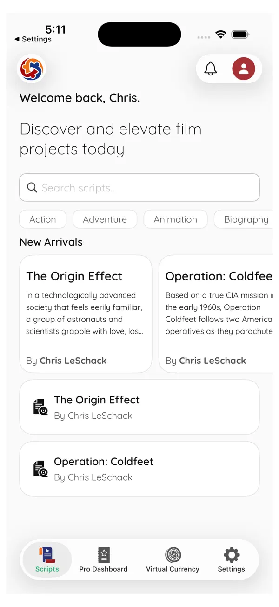
  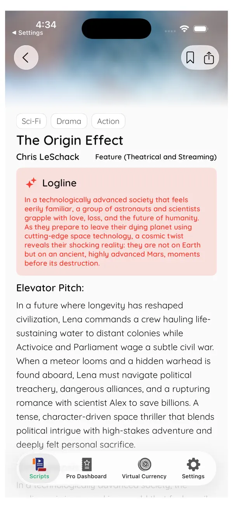
  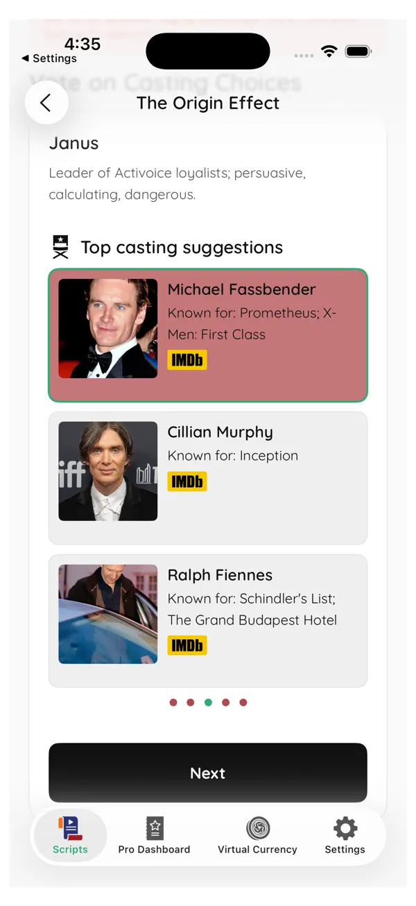

**Result: Live.** on the App Store and Google Play.

<b>Read the story</b>

**The challenge:** Help creators write and validate scripts, without risking their work.

**What I did**

- Built an AI app that helps write movie and book scripts.
- Added AI evaluation that suggests casting, shareable with directors and publishers.
- Let small private groups vote to validate a script, without compromising its confidentiality.

**Under the hood:** LLM integration with an evaluation pipeline, plus granular sharing permissions and a private voting system.

`LLM integration` · `AI evaluation pipeline` · `Secure sharing & permissions` · `Voting system`

[imogul.ai ↗](https://www.imogul.ai/) · [App Store ↗](https://apps.apple.com/us/app/imogul/id6749025373)

### Happy Sleep

*The app that talks to an FDA-cleared smart ring.* 
`Healthcare` `Hardware & BLE` `Wearables` `Performance`

  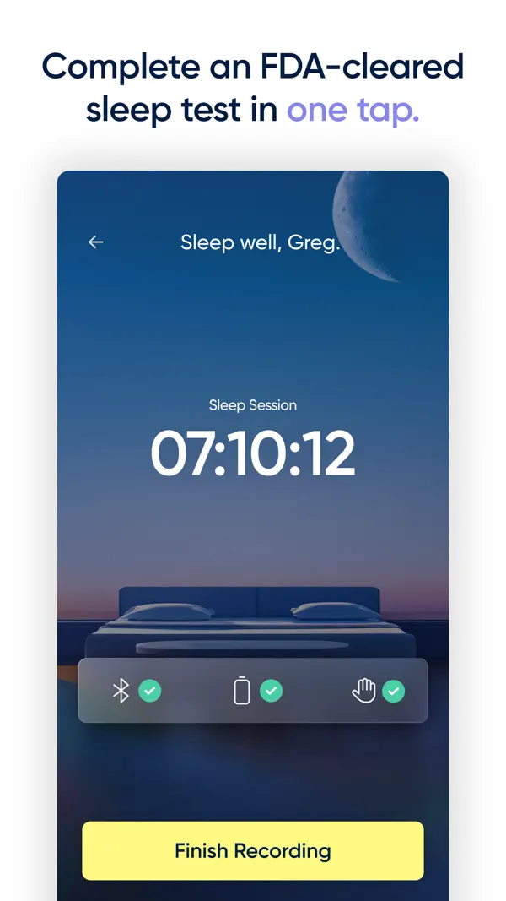
  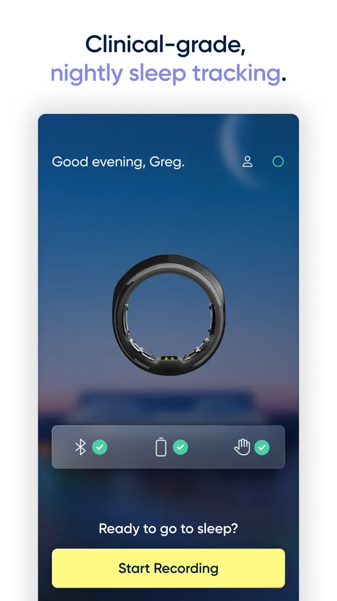
  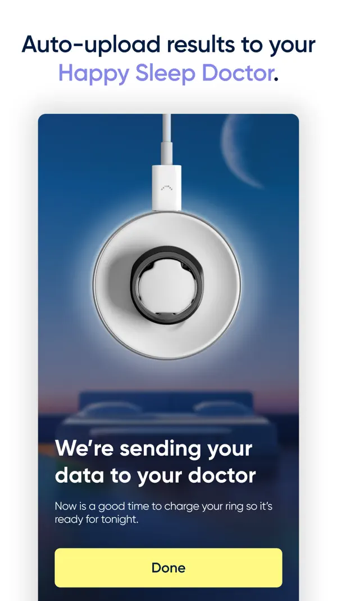

**Result: All night, every signal.** Battery-optimized ring tracking, without losing real-time data or statistics. Happy Ring is FDA-cleared; the app is listed as HIPAA-compliant (App Store listing, Sept 2026).

<b>Read the story</b>

**The challenge:** An at-home sleep test built around a medical-grade health ring. The app had to talk to the ring reliably all night, with almost no documentation to work from.

**What I did**

- **Made the ring talk to the app.** Built the library that communicates with the health ring, and got it working with close to zero documentation.
- **Optimized every line.** Working with a large hardware vendor, I tuned each line of code and each piece of logic to run as efficiently as possible.
- **Saved battery, kept the data.** Cut battery use without losing any important information or statistics.
- **Stayed real-time.** Kept live data flowing through the whole night-long sleep test.

**Under the hood:** A Bluetooth Low Energy communication library for the ring, built from minimal vendor documentation. It covers connection handling, real-time data streaming, and battery-aware data collection, profiled and tuned line by line.

`Bluetooth Low Energy` · `CoreBluetooth` · `Device communication library` · `Real-time streaming` · `Battery optimization` · `Performance profiling` · `HIPAA-conscious data handling`

[happysleep.com ↗](https://www.happysleep.com/) · [App Store ↗](https://apps.apple.com/us/app/happy-sleep-at-home-testing/id6446033851)

### Expo Pass

*Offline-first event platform with hardware payments.* 
`B2B` `Events` `Offline-First` `Hardware` `Payments`

  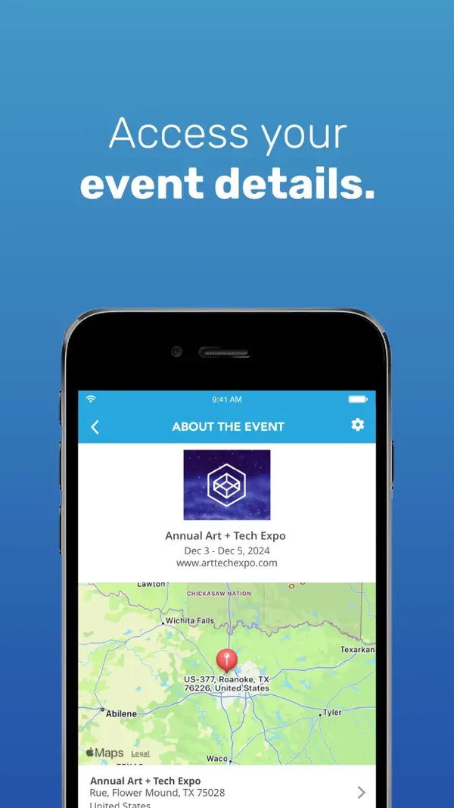
  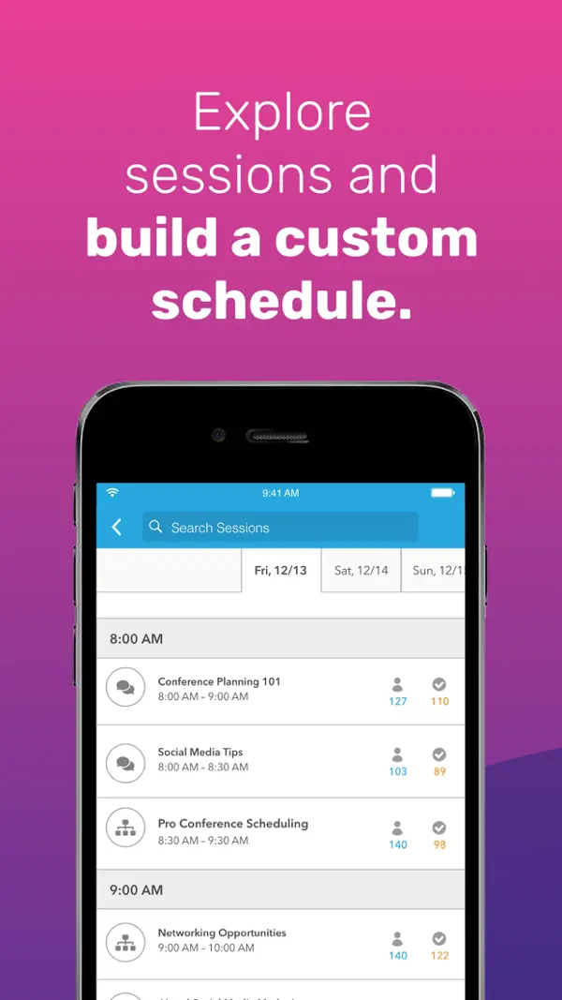
  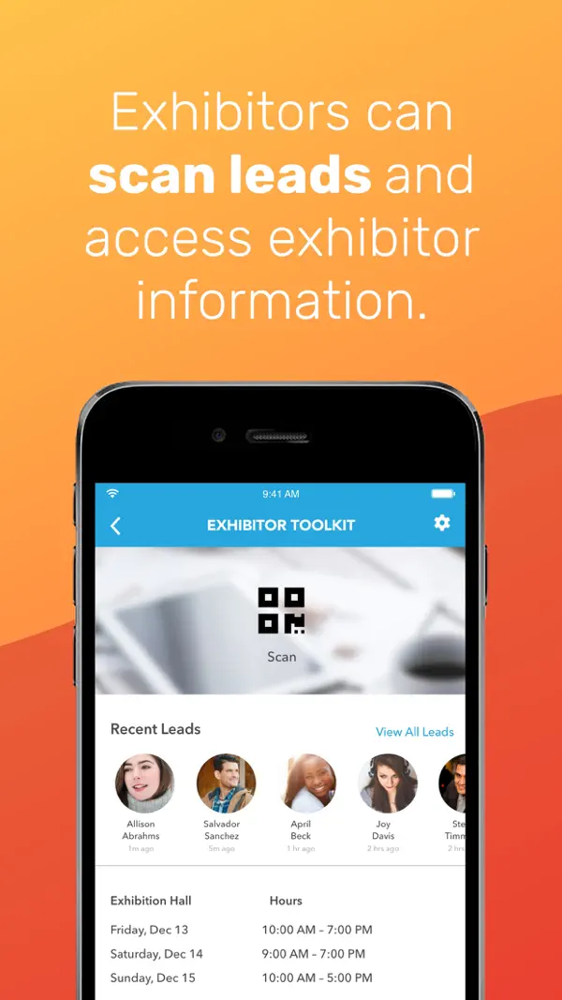

**Result: 0 records lost.** Check-in and payments at high-traffic events, online or off.

<b>Read the story</b>

**The challenge:** Event check-in and payments can't fail just because the venue Wi-Fi does.

**What I did**

- Converted the app from online-only to offline-first. It keeps working without internet.
- Built a sync system where the device is the source of truth and no record can ever be lost, with batch sizes that adapt to each user's bandwidth.
- Made card payments work offline too, with Stripe Terminal: reader connection, firmware updates, and syncing.
- Merged two separate sync pipelines (data and payments) into one, guarded by hundreds of constraints that prevent duplicate records.

**Under the hood:** Local-first data layer with deterministic conflict resolution, adaptive batching, and idempotent uploads. Payments use Stripe Terminal's offline mode with Bluetooth readers and managed firmware updates.

`Offline-first architecture` · `Conflict resolution` · `Adaptive batching` · `Stripe Terminal (offline)` · `Bluetooth card readers` · `Firmware management` · `Deduplication constraints`

[expopass.com ↗](https://www.expopass.com/) · [App Store ↗](https://apps.apple.com/us/app/expo-pass/id921625648)

### MapleHR

*A modular, plug-and-play HR platform.* 
`B2B SaaS` `Full-Stack` `Modular Architecture`

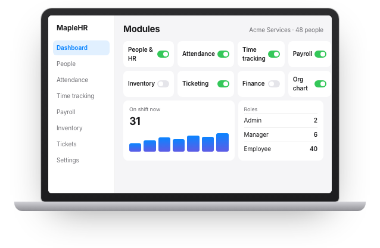

**Result: Pay per module.** Customers switch on only what they use.

<b>Read the story</b>

**The challenge:** One product that fits any service company, without making customers pay for features they don't need.

**What I did**

- Architected a modular platform: inventory, time tracking, org structure, role-based access, ticketing, finance and payroll, HR, and attendance.
- Made every module plug-and-play, so customers buy only what they need.
- Led two junior developers and set up CI/CD and monitoring.

**Under the hood:** Module boundaries with independent enablement per tenant, role-based access control, and CI/CD with monitoring from day one.

`Modular architecture` · `RBAC` · `Multi-module B2B SaaS` · `CI/CD` · `Monitoring`

[MapleHR on LinkedIn ↗](https://www.linkedin.com/company/maplehr/)

### eatOS

*One restaurant system, on every screen.* 
`B2B` `Restaurants` `POS` `Full-Stack` `Multi-platform`

  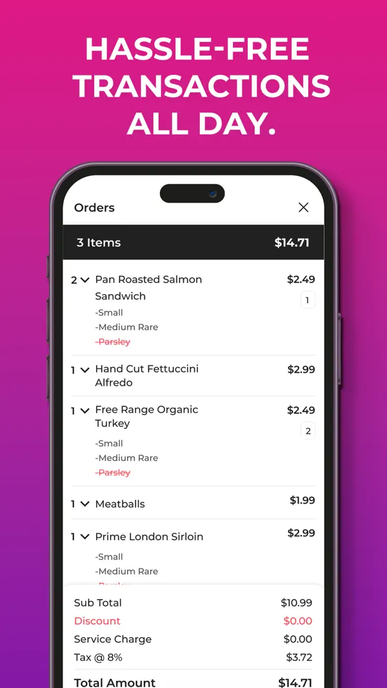
  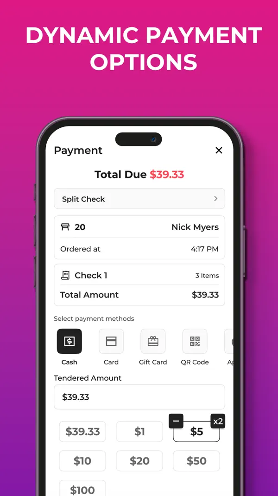
  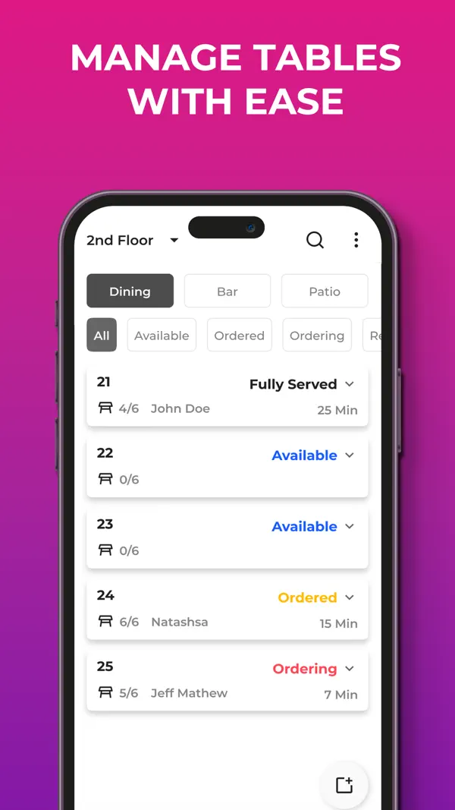

**Result: One app.** for staff and guests, across POS, large displays, iPad, and iPhone. eatOS reports 99.9% uptime and $2B+ processed across its platform (eatos.com, Sept 2026).

<b>Read the story</b>

**The challenge:** Restaurants need one system that runs the back of house and serves guests, on every kind of device they own.

**What I did**

- Built eatOS as one solution, once and for all: internal operations and customer-facing experiences in a single product.
- Made it work on every platform restaurants use: POS terminals, large displays, iPad, and iPhone.
- Covered the full service flow: order taking, flexible payments and split checks, ticket management, and table management.

**Under the hood:** One product that covers front of house, back of house, and guest-facing screens, with layouts adapted to each form factor, from handheld to large display.

`iPhone & iPad` · `POS terminals` · `Large-display layouts` · `Adaptive UI` · `Payments & split checks` · `Ticket & table management`

[eatos.com ↗](https://eatos.com/) · [App Store ↗](https://apps.apple.com/us/app/restaurant-point-of-sale-eatos/id1478907136)

### Savewise

*From AI prototype to premium product.* 
`Consumer` `Fintech & Savings` `Rebuild` `iOS + Web Extension`

  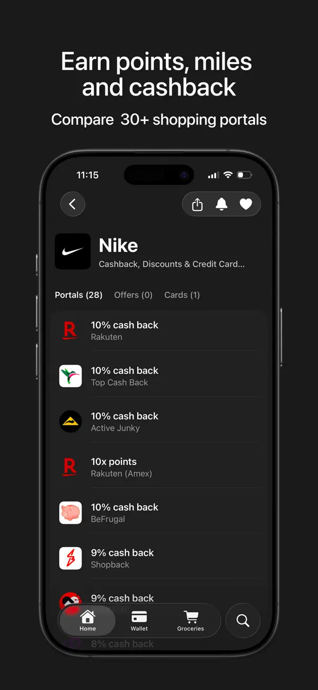
  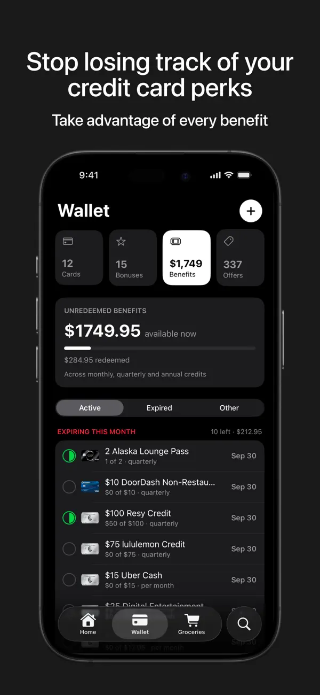
  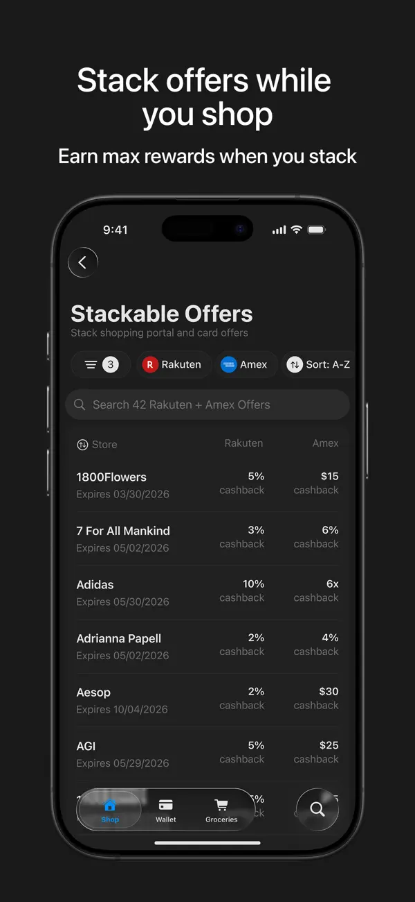

**Result: Prototype → Premium.** without pausing the business. App Store rating: 4.6★ from 200+ ratings (Sept 2026).

<b>Read the story</b>

**The challenge:** An AI-generated prototype, with real early customers already waiting on it.

**What I did**

- Turned the prototype into a polished, premium app while it was live, keeping early customers happy and working through their feature requests.
- Re-architected it into a modular codebase that's easy to grow.
- Redesigned the experience with an Apple-native, glass-style design system.
- Built cashback, rewards, offer comparison, offer history analytics, and subscriptions with in-app purchases.
- Shipped a Safari extension that stays in sync with the mobile app.

**Under the hood:** Feature modules with clear boundaries, a shared design system, StoreKit entitlements, and a Safari Web Extension sharing state with the app. Networking and caching tuned for fast offer lookups.

`Swift` · `SwiftUI` · `Modular architecture` · `Safari Web Extension` · `StoreKit subscriptions` · `Caching & networking` · `Cross-surface sync`

[getsavewise.com ↗](https://getsavewise.com/) · [App Store ↗](https://apps.apple.com/us/app/credit-card-rewards-savewise/id6740288292)

### Chick-fil-A

*Delivery optimization for one of America's favorite apps.* 
`Enterprise` `Logistics` `Consumer`

  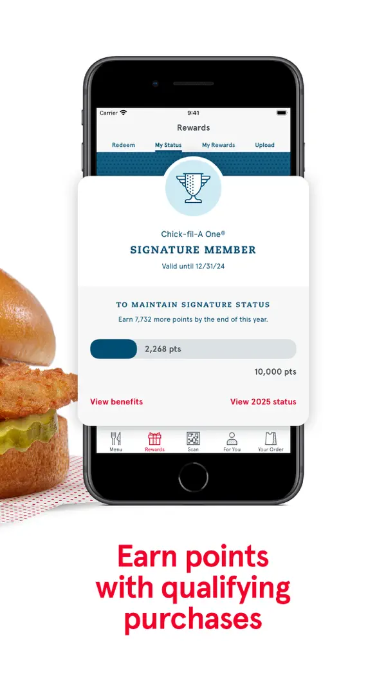
  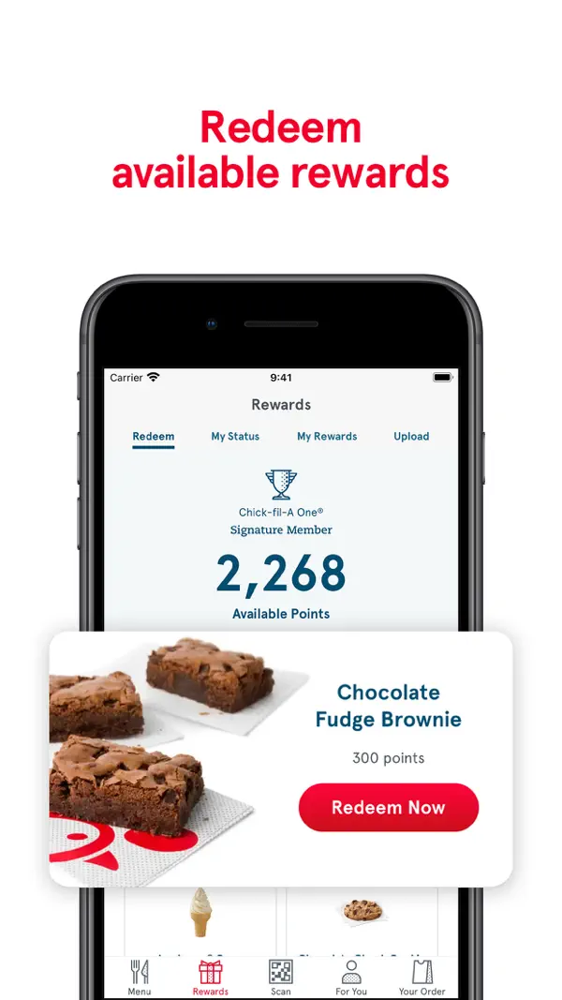
  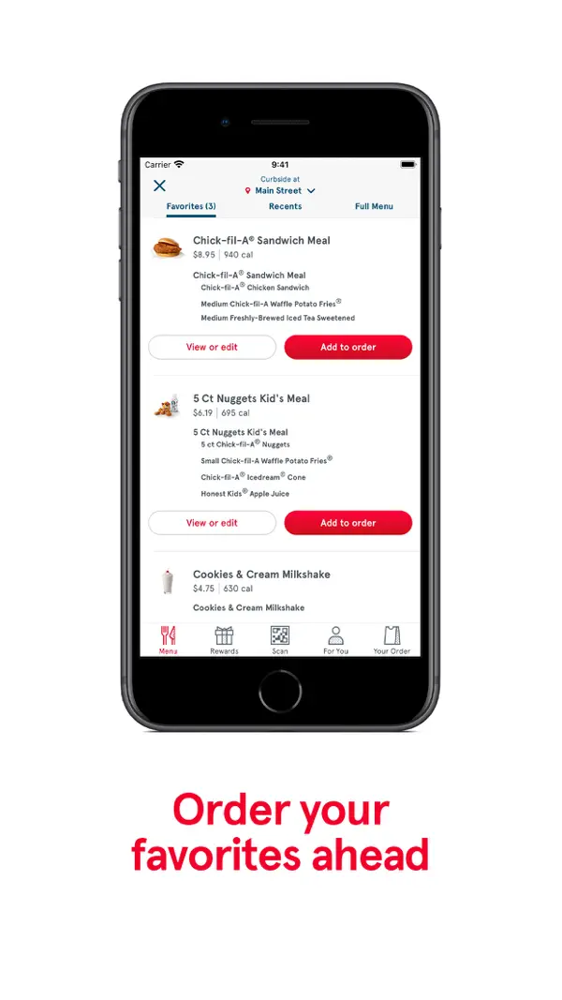

**Result: 80%+.** automated test coverage, with smarter dispatch and delivery routes. Chick-fil-A app: 4.9★ from 4.2M+ App Store ratings (Sept 2026).

<b>Read the story</b>

**The challenge:** Get food to customers faster and hotter, while drivers handle multiple orders at once.

**What I did**

- Worked on the delivery side: group delivery and dispatch.
- Built multi-drop route optimization, so food stays hot on every stop.
- Contributed to rewards and personalized menu features.
- Raised automated test coverage above 80% and wired it into CI/CD.

**Under the hood:** Route ordering logic for multi-drop deliveries, real-time status updates, and a test suite enforced in CI on every pull request.

`iOS` · `Swift` · `Route optimization` · `Real-time updates` · `XCTest` · `GitHub Actions`

[chick-fil-a.com ↗](https://www.chick-fil-a.com/) · [App Store ↗](https://apps.apple.com/us/app/chick-fil-a/id488818252)

### Scheduling Management Platform

*Legacy rescue and a full rating turnaround.* 
`B2B` `SaaS` `Legacy Rescue`

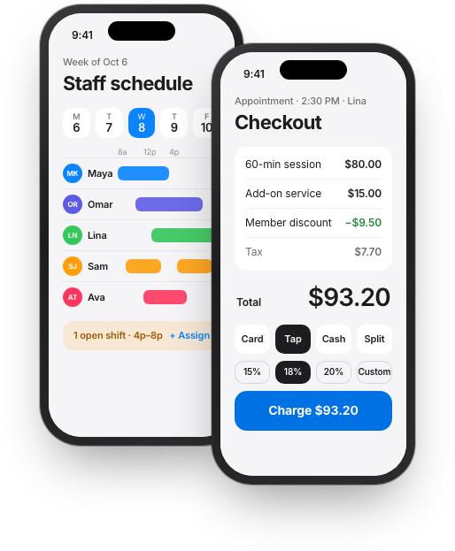

**Result: 2.8★ → 4.5★.** App Store rating in one year. Launch time cut from 60s to 30s, and from 7s to under 2s.

🔒 Client name withheld under confidentiality.

<b>Read the story</b>

**The challenge:** A B2B legacy app full of bugs, tight deadlines, and unhappy users.

**What I did**

- Kept shipping new features while fixing bugs under tight deadlines, using smart engineering trade-offs.
- Led the migration of the app to a modern cross-platform stack.
- Ran a focused quality program on crashes, stability, and the release process.
- Cut launch time from 60 seconds to 30, and from 7 seconds to under 2.

**Under the hood:** Incremental migration from a legacy codebase to a modern cross-platform stack, crash triage driven by monitoring data, and a predictable release process.

`Legacy migration` · `Cross-platform` · `Launch-time optimization` · `Crash reduction` · `Stability engineering` · `Release management`

### More work

<b>7 more projects</b> — healthcare, AI, logistics, EdTech, marketplaces

#### Wise Systems
*Legacy freight app, stabilized and modernized.* `Logistics` `Enterprise` `Legacy Modernization`

**Result: ~30% faster.** load times, and ~50% better user retention.

- Found and fixed memory leaks and stabilized the app.
- Migrated Objective-C to Swift and refactored to MVVM.
- Added real-time delivery status and driver tracking.

Objective-C · Swift · MVVM · Instruments · PubNub [wisesystems.com ↗](https://www.wisesystems.com/) · [App Store ↗](https://apps.apple.com/us/app/wise-systems/id1112016829)

#### HealHub
*AR and secure AI health, on AWS.* `Healthcare` `AR` `AI` `Compliance`

**Result: HIPAA-ready.** A live AR + AI health app, with patient data encrypted at rest and in transit.

- Built and optimized the AR experience for real users.
- Deployed a secure AI health model on AWS.
- Made the app HIPAA-compliant and encrypted end to end.

ARKit · AWS model hosting · Encryption at rest & in transit · HIPAA controls [HealHub on LinkedIn ↗](https://www.linkedin.com/company/healhubco/)

#### Anspar
*Privacy-first clinical study platform.* `Full-Stack` `Non-profit` `Healthcare` `Compliance`

**Result: Trust-first.** A research platform where participants keep control of their data.

- Designed the platform so data is never held in the middle: it lives with the participant or with the sponsor, nowhere else.
- Built for dynamic policies, rules, and regulations.
- Made the whole system fully auditable.

Zero-intermediary data flow · Policy/rules engine · Audit trails · Regulatory compliance [anspar.org ↗](https://anspar.org/)

#### Ntiva
*Training platform for Apple staff.* `Full-Stack` `B2B` `EdTech`

**Result: Ready day one.** New hires arrive trained, with every course, session, and evaluation in one place.

- Built the training system: course management, multiple instructors, and 1:many and 1:1 scheduling.
- Added evaluations and progress tracking.
- Maintained and updated courses over time.

Course management · Scheduling · Evaluations · Progress tracking [ntiva.com ↗](https://www.ntiva.com/)

#### Code-Generation LLM
*Training data for a leading tech company's code model.* `AI` `LLM` `Model Training`

**Result: Better code in.** means better code out. 🔒 Company kept unnamed, as is standard for model-training work.

- Polished and produced pre-training and post-training data for a code-generation model.

LLM training data · Pre-training · Post-training · Code quality review

#### Doktor24
*AI telemedicine in Sweden.* `Healthcare` `AI` `Europe`

**Result: Live.** on the Swedish App Store.

- Built appointment booking for onsite and online visits.
- Added an AI-driven patient triage questionnaire.
- Released it on the Swedish App Store.

iOS · AI triage · Booking & scheduling · Telemedicine [App Store (Sweden) ↗](https://apps.apple.com/se/app/doktor24-%C3%B6ppet-livetrunt/id1249339459)

#### Makwa
*A multi-service marketplace, rebuilt from scratch.* `Marketplace` `Flutter` `MENA`

**Result: One codebase.** for iOS and Android, built to grow subscriptions.

- Rebuilt the marketplace from scratch in Flutter as the sole mobile architect.
- Added payments, caching, and real-time order status.
- Built in A/B testing to grow subscription revenue.

Flutter · Dart · Clean Architecture · DDD · BLoC · Payments · A/B testing

---

### Tech I use

**Web & backend** 

**Mobile** 

**Cloud & DevOps** 

**Also:** LLM integration · AI evaluation pipelines · Bluetooth Low Energy · Stripe (online & Terminal) · HIPAA-ready architecture · Clean Architecture · CI/CD with 80%+ test coverage

### Let's build something

Have an idea, an AI prototype, or a product that needs rescuing? **[Book a free call](mailto:usamanaeem911@gmail.com?subject=Let's%20talk%20about%20my%20project)**. You'll leave with a clear plan either way.
